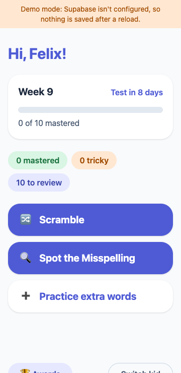
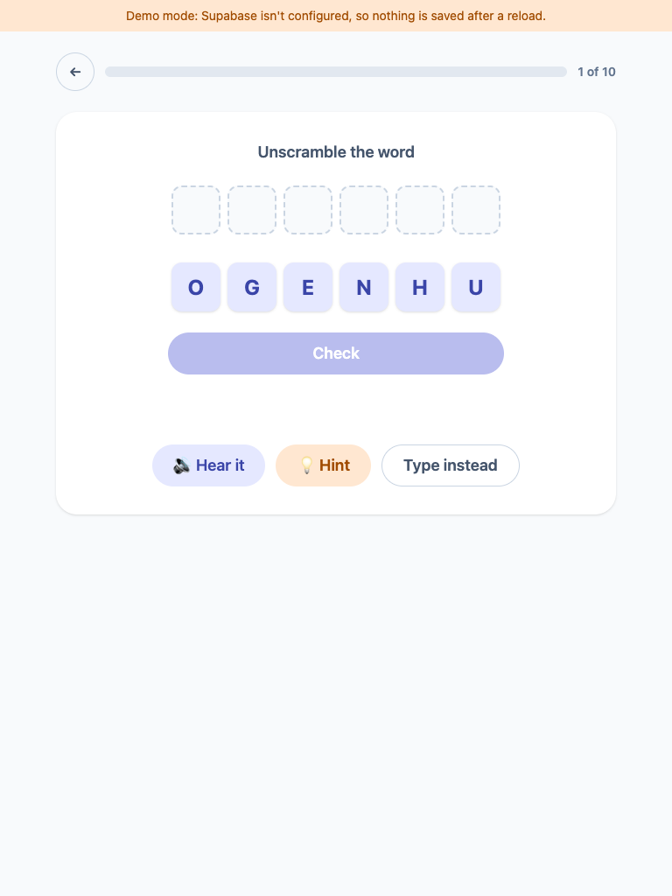
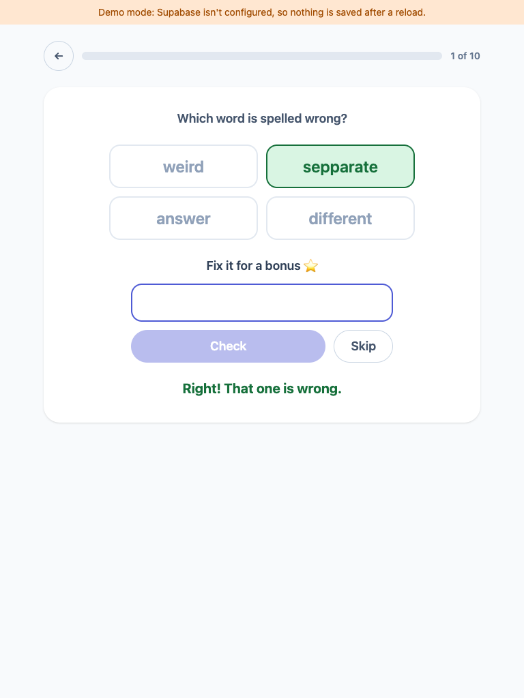
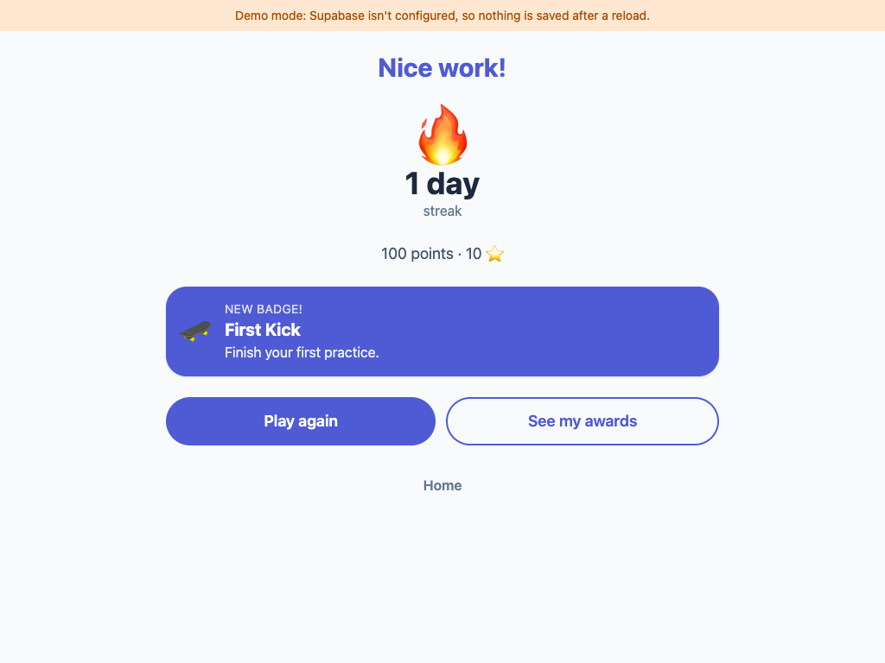
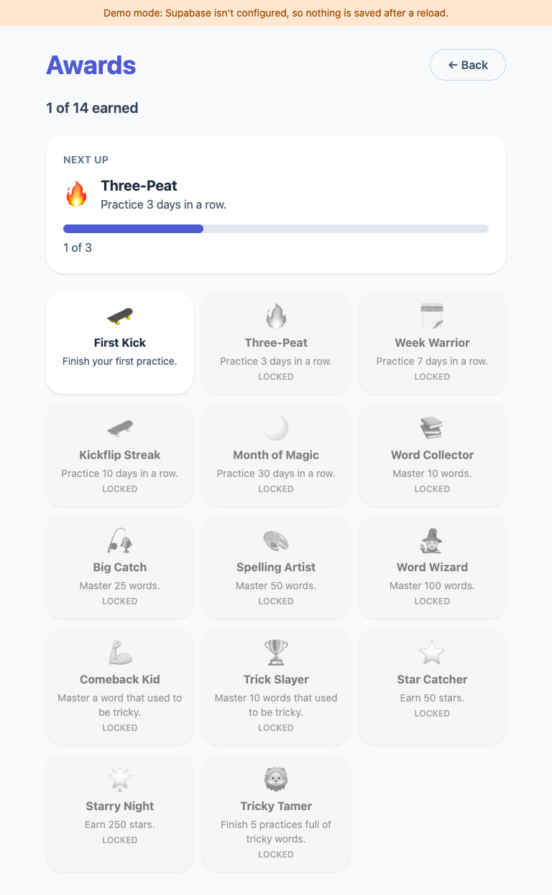

# SpellKick

A spelling practice web app for kids: enter your weekly spelling words, then practice them with games that track the tricky ones.

## What it is

A family-only PWA where each kid practices their weekly school spelling list. A parent (behind a PIN) adds kids and pastes in word lists. Kids play two short games, Scramble and Spot the Misspelling, over 10-word sessions. Tricky words come back until they are mastered, and kids earn a daily streak, stars and badges.

React 18, TypeScript, Vite, Tailwind v4, Supabase for sign-in and storage. Without Supabase env vars it runs in demo mode on an in-memory repo (nothing is saved after a reload).

| Kid home (360 px) | Scramble (768 px) | Spot the Misspelling (768 px) |
| --- | --- | --- |
|  |  |  |





## Development

```
npm install
npm run dev        # local dev server (demo mode if VITE_SUPABASE_* are unset)
npm test           # run tests
npm run lint       # lint
npm run typecheck  # type-check
npm run build      # production build
```

Hosting setup for a non-developer: see `docs/setup.md`. Copy `.env.example` to `.env.local` for local development.
